# Compte rendu — Stockage de matrices en C

**Membres du trinôme :** ADRHAMI Nizar, OUBIHI Wael et Thiam Adama  
**Identifiants GitHub :** nizaradrhami, wvael et kancou77

## Table des matières

- [1. Introduction](#1-introduction)
- [2. Conception et compilation](#2-conception-et-compilation)
- [3. Réalisation par exercice](#3-réalisation-par-exercice)
- [4. Vérifications mémoire](#4-vérifications-mémoire)
- [5. Démonstration finale](#5-démonstration-finale)
- [6. Bilan et répartition du travail](#6-bilan-et-répartition-du-travail)

## 1. Introduction

Le projet consiste à réaliser une bibliothèque C permettant d’allouer, de détruire, de lire, d’écrire, d’afficher, d’additionner et de multiplier des matrices d’entiers. Un programme de démonstration utilise cette bibliothèque pour lire deux matrices dans des fichiers et enregistrer le résultat d’une opération.

Les principaux points étudiés sont la programmation modulaire, l’allocation dynamique, la propriété de la mémoire, les fichiers texte et le traitement des erreurs.

**État du projet :** les exercices 1 à 3 passent leurs tests (16/16, 14/14 et 14/14). Le programme de démonstration produit les résultats attendus dans les scénarios présentés. Valgrind ne détecte aucune fuite ni erreur mémoire lors des exécutions documentées.

## 2. Conception et compilation

| Fichiers | Rôle |
|---|---|
| `matrice.h`, `matrice.c` | Type `Matrice`, codes et messages d’erreur, validation |
| `matrice_alloc.h`, `matrice_alloc.c` | Allocation et destruction |
| `matrice_io.h`, `matrice_io.c` | Lecture, écriture et affichage |
| `matrice_calcul.h`, `matrice_calcul.c` | Addition et multiplication |
| `main.c` | Programme `demo_matrices` |
| `test_ex1.c`, `test_ex2.c`, `test_ex3.c` | Tests fournis |
| `donnees/` | Matrices d’exemple et fichiers invalides |
| `Makefile` | Compilation, lancement des tests et nettoyage |

Les fichiers `.h` constituent les interfaces imposées. Les définitions des fonctions se trouvent dans les `.c` ; aucun fichier `.c` n’est inclus par un autre.

La structure `Matrice` contient les dimensions et un pointeur `int **coef`. Celui-ci désigne un tableau de pointeurs vers les lignes, allouées séparément. L’accès à un coefficient s’écrit `m.coef[i][j]`, avec des indices commençant à zéro.

Le contrat de la bibliothèque prévoit l’initialisation à `MATRICE_VIDE`, le transfert de propriété du résultat à l’appelant en cas de succès et la libération des allocations partielles en cas d’échec. L’appelant détruit les résultats dont il est propriétaire. Les entrées restent inchangées et le résultat possède sa propre mémoire.

Les fonctions susceptibles d’échouer renvoient un `MatErreur`. Le programme principal interprète ce code et affiche les messages. Le code qui ouvre un fichier est également responsable de sa fermeture.

### Relations entre modules

Le schéma suivant représente les responsabilités et les appels entre modules . 

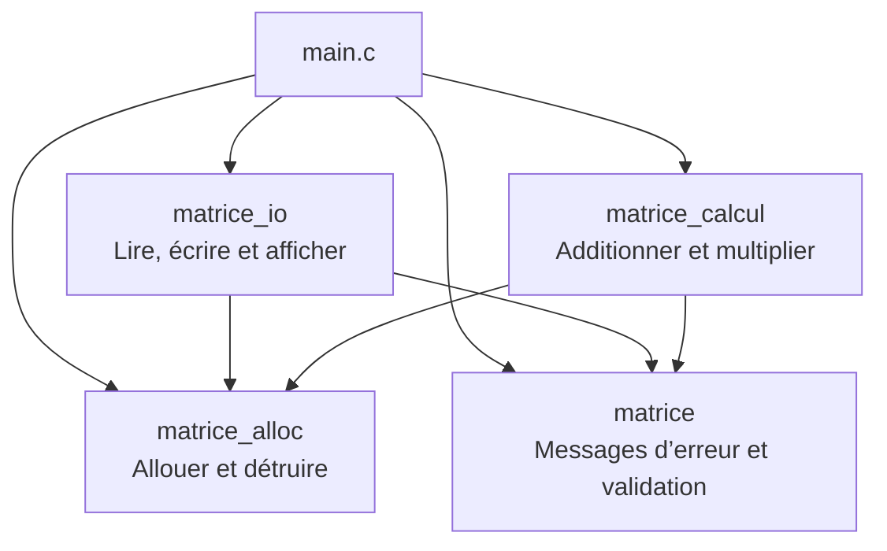

### Inclusions et visibilité

Chaque fichier d’implémentation inclut son propre en-tête pour vérifier la cohérence entre les prototypes et les définitions. Les en-têtes des modules utilisent le type `Matrice` défini dans `matrice.h`. Le module d’entrées-sorties utilise aussi `FILE`, fourni par `<stdio.h>`.

Les gardes `#ifndef`, `#define` et `#endif` empêchent de traiter plusieurs fois le même en-tête dans une unité de traduction. Elles évitent notamment de redéfinir la structure lorsque plusieurs modules incluent indirectement `matrice.h`.

Les fonctions internes sont déclarées `static` pour limiter leur visibilité au fichier qui les définit. Dans le squelette fourni, c’est notamment le cas des fonctions `charger` et `sauvegarder` de `main.c` . Elles ne font pas partie de l’interface publique.

### Propriété de la mémoire

| Règle | Responsabilité |
|---|---|
| R1 | Initialiser chaque matrice à `MATRICE_VIDE`. |
| R2 | En cas de succès, transférer la propriété du résultat à l’appelant. |
| R3 | En cas d’échec, libérer les allocations temporaires et laisser la sortie vide. |
| R4 | Ne pas modifier ni libérer les matrices d’entrée. |
| R5 | Détruire l’ancien contenu de la sortie avant l’appel et utiliser une sortie distincte des entrées. |
| R6 | Remettre une matrice détruite à vide pour autoriser une nouvelle destruction sans effet. |
| R7 | Fermer chaque flux dans le code qui l’a ouvert. |

L’allocation à deux niveaux nécessite de traiter l’échec partiel : si une ligne ne peut pas être réservée, les lignes déjà créées sont libérées avant le tableau de pointeurs. Pour les calculs, les conversions vers `long long` ont lieu avant l’opération .Le résultat est vérifié avant sa conversion en `int`. L’accumulation du produit matriciel exige également un contrôle avant chaque addition dans le `long long`.

### Compilation et utilisation

Le projet utilise un compilateur C compatible C11 et `make`. Les options de compilation sont :

```text
-std=c11 -Wall -Wextra -Wpedantic -g
```

Depuis la racine du dépôt :

```bash
make              # Construit les trois tests et demo_matrices
make test         # Lance les trois tests
make test1        # Lance seulement le test de l’exercice 1
make test2        # Lance seulement le test de l’exercice 2
make test3        # Lance seulement le test de l’exercice 3
make clean        # Supprime les exécutables et les sorties prévues par clean
```

Les tests sont compilés avec `-DMAT_TEST_ALLOC` pour permettre les échecs d’allocation simulés. `demo_matrices` est compilé sans cette option. Le Makefile compile les sources nécessaires à chaque programme en une commande ; il ne conserve pas de fichiers objets intermédiaires.

La commande complète de compilation de la démonstration est :

```bash
gcc -std=c11 -Wall -Wextra -Wpedantic -g \
  main.c matrice.c matrice_alloc.c matrice_io.c matrice_calcul.c \
  -o demo_matrices
```

Utilisation du programme :

```bash
./demo_matrices add donnees/A.txt donnees/B.txt R.txt
./demo_matrices mul donnees/A.txt donnees/C.txt R.txt
```

Un fichier de matrice commence par deux entiers indiquant le nombre de lignes et de colonnes. Les coefficients suivent. L’écriture utilise un espace entre deux coefficients, aucun espace en fin de ligne et un saut de ligne après chaque ligne. La lecture accepte des espaces, tabulations et sauts de ligne entre les entiers.


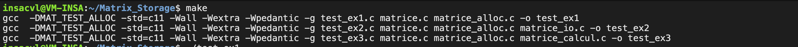

## 3. Réalisation par exercice

### Exercice 1 — Outils communs, allocation et destruction

Fichiers : [matrice.c] et [matrice_alloc.c].

Le travail porte sur les messages d’erreur, la validité des matrices, le contrôle des arguments, l’allocation des lignes, le transfert du résultat et sa destruction. La fonction de validation utilise le court-circuit de `&&` pour vérifier le pointeur avant d’accéder à ses champs.

Extrait de l’étape **1.b**, extrait de notre code :

```c
/* Vérifier le pointeur, les coefficients et les bornes des dimensions. */
return (m != NULL && m->coef != NULL && m->nb_lignes >= 1 &&
        m->nb_lignes <= MAT_DIM_MAX && m->nb_colonnes >= 1 &&
        m->nb_colonnes <= MAT_DIM_MAX);
```

**Étape 1.a**

```c
case MAT_ERR_DIMENSIONS:
  return "dimensions incompatibles";
case MAT_ERR_DEPASSEMENT:
  return "dépassement de la mémoire";
```


**Étape 1.c**

```c
if (nb_lignes < 1 || nb_lignes > MAT_DIM_MAX || nb_colonnes < 1 ||
      nb_colonnes > MAT_DIM_MAX)
    return MAT_ERR_ARGUMENT;
```

**Étape 1.d**

```c
for (int i = 0; i < nb_lignes; i++) {
    coef[i] = mat_calloc((size_t)nb_colonnes, sizeof *coef[i]);
    if (coef[i] == NULL) {
      for (int k = i - 1; k >= 0; k--)
        free(coef[k]);
      free(coef);
      return MAT_ERR_ALLOCATION;
    }
  }
```

**Étape 1.e**

```c
res->coef = coef;
  res->nb_lignes = nb_lignes;
  res->nb_colonnes = nb_colonnes;
  return MAT_OK;
```

**Étape 1.f**

```c
for (int i = 0; i < m->nb_lignes; i++) {
  free(m->coef[i]);
}
free(m->coef);
```

Sortie de `test_ex1` :

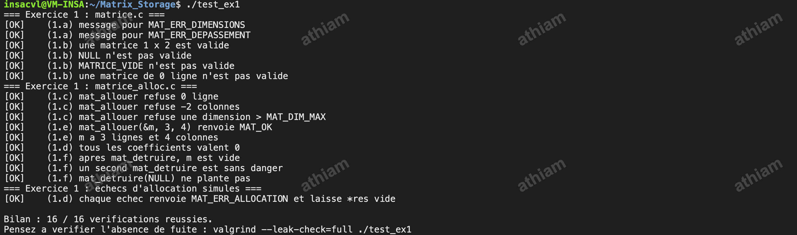

**Q3.1 — Pourquoi passer un pointeur à `mat_detruire` ?**

Le pointeur permet de modifier la structure de l’appelant pour la remettre à `MATRICE_VIDE`. Avec un passage par valeur, les blocs pourraient être libérés, mais la structure originale conserverait des pointeurs vers de la mémoire libérée.

**Q3.2 — Combien d’allocations et de libérations ?**

Une matrice de n lignes nécessite n + 1 allocations : le tableau de pointeurs et les n lignes. Sa destruction nécessite n + 1 libérations. Si la k-ième allocation échoue, en comptant le tableau de pointeurs comme première allocation, les k − 1 blocs déjà alloués doivent être libérés.

**Q3.3 — Pourquoi deux destructions sont-elles sans danger ?**

La première destruction remet la matrice à vide ; la seconde ne possède donc plus de bloc à libérer. En revanche, `Matrice b = a` réalise une copie superficielle : les deux structures partagent les mêmes blocs. Détruire a puis b peut provoquer un accès à de la mémoire libérée et une double libération. Une copie indépendante exige de nouvelles allocations et une copie des coefficients.

**Q3.4 — Pourquoi initialiser le résultat avant de vérifier les dimensions ?**

Après vérification que `res` n’est pas `NULL`, cette initialisation garantit que même une erreur de dimensions laisse un résultat vide. L’appelant doit avoir détruit un éventuel ancien contenu avant l’appel, sinon cette affectation ferait perdre son adresse.

### Exercice 2 — Entrées-sorties

Fichier : [matrice_io.c](matrice_io.c).

L’affichage parcourt les coefficients ligne par ligne. L’écriture doit respecter le format canonique, et la lecture doit construire un résultat temporaire avant de le transférer à l’appelant. Si une donnée est invalide, les ressources temporaires doivent être libérées.

**Étape 2.a**

```c
for(int i=0; i < m->nb_lignes; i++) {
        for(int j=0; j < m->nb_colonnes ; j++) {
            printf(" %8d", m->coef[i][j]);
        }
        putchar('\n');
    }
```

**Étape 2.b**

```c
for (int i=0; i < m->nb_lignes; i++) {
        for (int j=0; j < m->nb_colonnes; j++) {
            if(fprintf(f, j == 0 ? "%d" : " %d", m->coef[i][j]) < 0)
                return MAT_ERR_ECRITURE;
        }
        if(fputc('\n', f) == EOF)
            return MAT_ERR_ECRITURE;
    }
```

**Étape 2.c**

```c
if (nb_lignes < 1 || nb_lignes > MAT_DIM_MAX || nb_colonnes < 1 
        || nb_colonnes > MAT_DIM_MAX)
        return MAT_ERR_FORMAT;
```

**Étape 2.d**

```c
Matrice tmp;
    err = mat_allouer(&tmp, nb_lignes, nb_colonnes);
    if (err != MAT_OK) return err;
```

**Étape 2.e**

```c
for (int i=0; i < nb_lignes; i++) {
        for (int j=0; j < nb_colonnes; j++) {
            err = lire_entier(f, &tmp .coef[i][j]);
            if (err != MAT_OK) {
                mat_detruire(&tmp);
                return err;
            }
        }
    }
```

**Étape 2.f**

```c
*res = tmp;
    return MAT_OK;
```

Sortie du test :

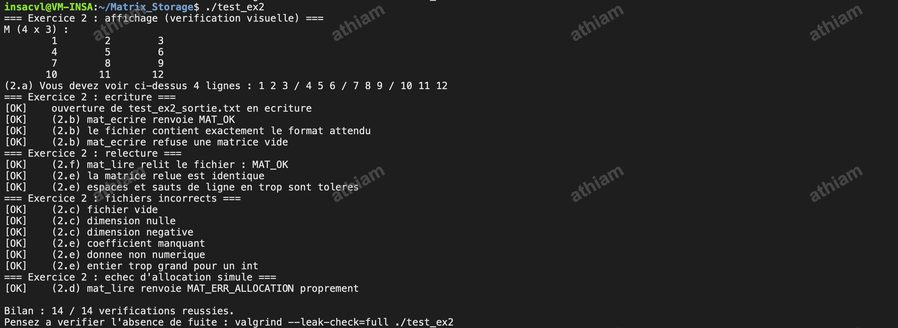

L’affichage montre aussi les quatre lignes attendues : `1 2 3`, `4 5 6`, `7 8 9`, `10 11 12`.


**Q4.1 — Pourquoi construire une matrice locale ?**

La matrice locale permet de lire et de vérifier tous les coefficients avant de transférer le résultat. En cas d’erreur, elle est détruite et le résultat reste vide . Aucune matrice partiellement lue n’est transmise.

**Q4.2 — Chaque ligne doit-elle occuper sa propre ligne de texte ?**

Non. Les dimensions déterminent l’organisation des coefficients et les blancs sont des séparateurs. La lecture accepte ainsi plusieurs mises en forme, tandis que l’écriture produit un format canonique, lisible et reproductible.

**Q4.3 — Comment stocker deux matrices dans le même fichier ?**

On écrit successivement les deux matrices sur le même flux. Pour les relire, on appelle deux fois `mat_lire` sans revenir au début du fichier, avec deux matrices de destination distinctes initialisées à vide, en vérifiant chaque retour.

**Q4.4 — Pourquoi utiliser `fflush` et vérifier aussi `fclose` ?**

Les écritures sont tamponnées. `fflush` force la transmission des données du tampon et permet de détecter une erreur avant de renvoyer `MAT_OK`. Il ne remplace pas la fermeture : l’appelant doit toujours appeler `fclose` et vérifier son résultat, car la fermeture peut aussi échouer.

### Exercice 3 — Calcul matriciel

Fichier : [matrice_calcul.c].

L’addition exige des dimensions identiques et parcourt chaque coefficient. Pour le produit, le nombre de colonnes de la première matrice doit correspondre au nombre de lignes de la seconde. Les trois boucles calculent chaque résultat à partir d’une ligne et d’une colonne. Le résultat possède ses propres allocations et les dépassements doivent entraîner un nettoyage avant le retour d’erreur.

**Étape 3.a**

```c
if (a->nb_lignes != b->nb_lignes || a->nb_colonnes != b->nb_colonnes )
        return MAT_ERR_DIMENSIONS;
```

**Étape 3.b**

```c
Matrice r = MATRICE_VIDE;
    err = mat_allouer(&r, a->nb_lignes, a->nb_colonnes);
    if (err != MAT_OK)
        return err;
```

**Étape 3.c**

```c
long long s = (long long)a->coef[i][j] + b->coef[i][j];
```

**Étape 3.d**

```c
*res = r;            
    return MAT_OK;
```

**Étape 3.e**

```c
if (a->nb_colonnes != b->nb_lignes)
        return MAT_ERR_DIMENSIONS;
```

**Étape 3.f**

```c
Matrice r = MATRICE_VIDE;
    err = mat_allouer(&r, a->nb_lignes, b->nb_colonnes);
    if (err != MAT_OK)
        return err;
```

**Étape 3.g**

```c
for (int k = 0; k < a->nb_colonnes; k++) {
                   long long p = (long long)a->coef[i][k] * b->coef[k][j];
                   if ((p > 0 && s > LLONG_MAX - p)
                       || (p < 0 && s < LLONG_MIN - p)) {
                       mat_detruire(&r);
                       return MAT_ERR_DEPASSEMENT;
                   }
                   s += p;
               }
```

**Étape 3.h**

```c
*res = r;
    return MAT_OK;
```

Sortie du test :

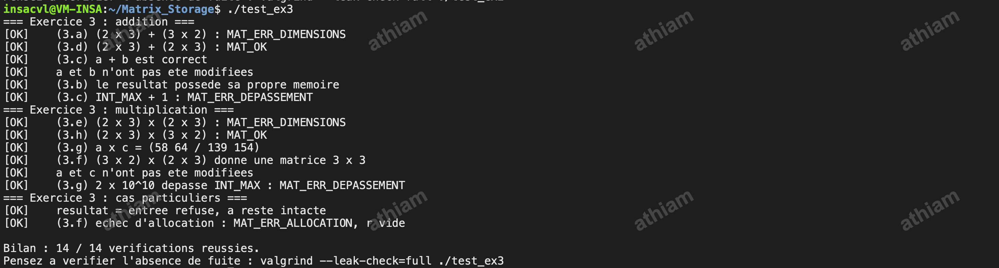


**Q5.1 — Que protège `const Matrice *a` ?**

Il empêche de modifier les champs de la structure à travers a, mais ne rend pas les entiers pointés constants. L’instruction `a->coef[0][0] = 7` reste donc autorisée par le type actuel. Il faudrait concevoir une interface de lecture exposant des coefficients de type `const int`, ou une structure opaque avec des accesseurs. Convertir simplement un `int **` en `const int **` ne constitue pas une solution correcte. Dans ce TD, les interfaces sont conservées et la non-modification des coefficients est un contrat à respecter.

**Q5.2 — Pourquoi interdire `mat_additionner(&a, &b, &a)` ?**

L’entrée et la sortie désigneraient la même structure. L’initialisation du résultat à vide écraserait alors l’entrée et ferait perdre l’accès à ses allocations. Une opération en place demanderait une gestion spécifique, par exemple un résultat temporaire suivi d’un remplacement contrôlé.

**Q5.3 — Combien de multiplications sont nécessaires ?**

Pour une matrice n × p multipliée par une matrice p × q, l’algorithme effectue n × p × q multiplications. Deux matrices 1000 × 1000 demandent donc un milliard de multiplications. 

**Q5.4 — Pourquoi ne pas détecter le dépassement après une addition en `int` ?**

Un dépassement d’entier signé constitue déjà un comportement indéfini : le test effectué après le calcul n’est pas fiable. Le calcul doit être réalisé dans un type suffisamment large, puis comparé à `INT_MIN` et `INT_MAX` avant conversion. Pour le produit matriciel, il faut également vérifier que l’accumulation ne dépasse pas la capacité de `long long` avant chaque addition.

### Exercice 4 — Démonstration

Fichier : [main.c].

Le programme assemble les modules pour afficher les entrées, choisir entre addition et multiplication, afficher le résultat et signaler la réussite après l’enregistrement. Les erreurs de calcul doivent préciser la cause et les dimensions concernées. Les traces des scénarios sont présentées dans la section 5.

**Étape 4.a**

```c
mat_afficher("A", &a);
    mat_afficher("B", &b);
```

**Étape 4.b**

```c
MatErreur err = addition ? mat_additionner(&a, &b, &r)
                             : mat_multiplier(&a, &b, &r);
    if (err != MAT_OK) {
        fprintf(stderr, "Erreur : calcul impossible : %s ",
                mat_message_erreur(err));
        fprintf(stderr, "(A : %d x %d, B : %d x %d)\n",
                a.nb_lignes, a.nb_colonnes, b.nb_lignes, b.nb_colonnes);
        goto nettoyage;
    }
```

**Étape 4.c**

```c
mat_afficher(addition ? "R = A + B" : "R = A x B", &r);
```

**Étape 4.d**

```c
printf("Résultat enregistré dans \"%s\".\n", argv[4]);
    statut = EXIT_SUCCESS;
```

**Q6.1 — Pourquoi afficher les erreurs dans `main.c` ?**

La bibliothèque renvoie une information exploitable sans imposer une présentation. Le programme appelant choisit de l’afficher sur le terminal. Cela facilite la réutilisation et les tests.

**Q6.2 — Pourquoi vérifier `fclose` dans `sauvegarder` ?**

La fermeture d’un flux d’écriture peut révéler une erreur lors de la transmission finale des données. En lecture, il n’y a pas de tampon de sortie à vider .Le code fourni contrôle les erreurs de lecture dans `mat_lire` et ne traite pas le retour de fermeture dans `charger`. Cela ne signifie pas qu’une fermeture en lecture est universellement incapable d’échouer.

**Q6.3 — Que libérer si l’enregistrement échoue après le calcul ?**

Les trois matrices A, B et R ont été allouées : elles doivent toutes être détruites. Le point de nettoyage commun prévu dans `main` permet de les libérer quelle que soit l’étape ayant échoué. Ce chemin doit aussi être vérifié sous Valgrind avec une destination inaccessible.

## 4. Vérifications mémoire

Les captures suivantes montrent les exécutions réalisées dans la VM Linux( Proxmox ) et leurs bilans mémoire.

### test_ex1

Commande : `valgrind --leak-check=full ./test_ex1`.

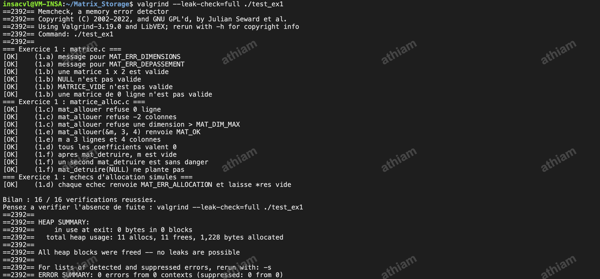

Les allocations sont toutes libérées, et aucune erreur mémoire n’a été détectée sur cette exécution, y compris pour les échecs d’allocation simulés.

### test_ex2

Commande : `valgrind --leak-check=full ./test_ex2`.

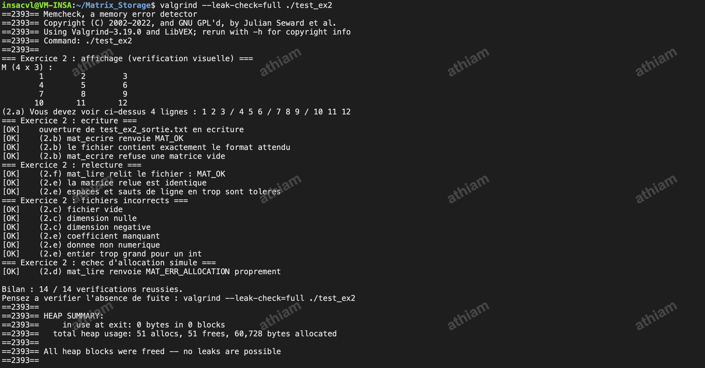

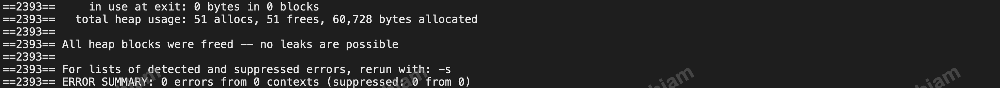

### test_ex3

Commande : `valgrind --leak-check=full ./test_ex3`.

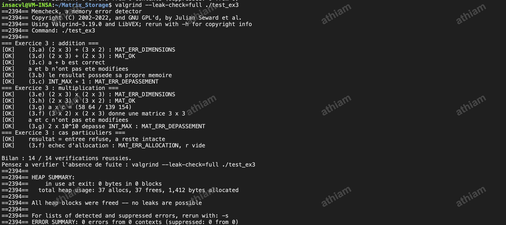

Ces captures présentent les résumés Valgrind de la VM. Aucun bloc ne reste alloué à la sortie et Valgrind ne détecte aucune erreur sur ces tests.

### demo_matrices — Succès

Commande exécutée :

```bash
valgrind --leak-check=full ./demo_matrices add donnees/A.txt donnees/B.txt R_add.txt
```

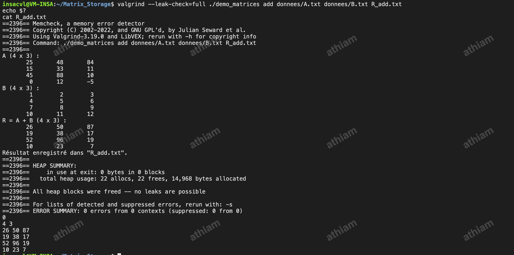

### demo_matrices — Erreur de dimensions

Même commande Valgrind, avec les arguments `add donnees/A.txt donnees/C.txt R_erreur.txt` :

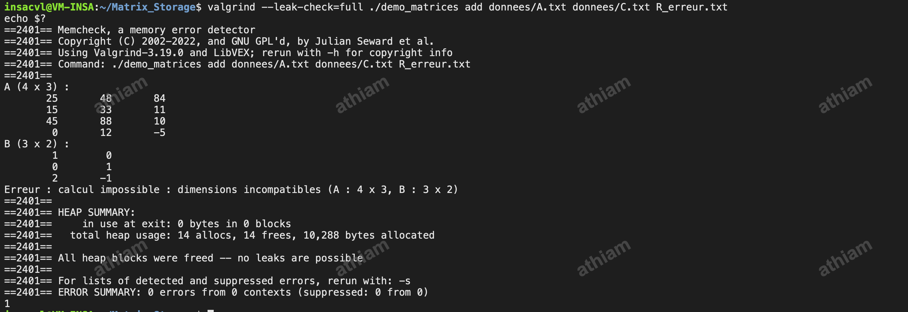

Le programme retourne 1 pour signaler l’échec fonctionnel. Ce code est attendu ; il ne correspond pas à une erreur mémoire. Les matrices d’entrée allouées avant le refus du calcul ont été libérées.

## 5. Démonstration finale
Les captures montrent la commande exécutée sous Valgrind, la sortie du programme et le code de retour affiché immédiatement avec `echo $?`.

### Scénario 1 — Addition de A et B

Commande : `valgrind --leak-check=full ./demo_matrices add donnees/A.txt donnees/B.txt R_add.txt`.


Code de retour : **0**. Le fichier affiché par `cat R_add.txt` contient la somme attendue. Valgrind ne détecte aucune fuite ni erreur mémoire.

### Scénario 2 — Multiplication de A et C

Commande : `valgrind --leak-check=full ./demo_matrices mul donnees/A.txt donnees/C.txt R_mul.txt`.

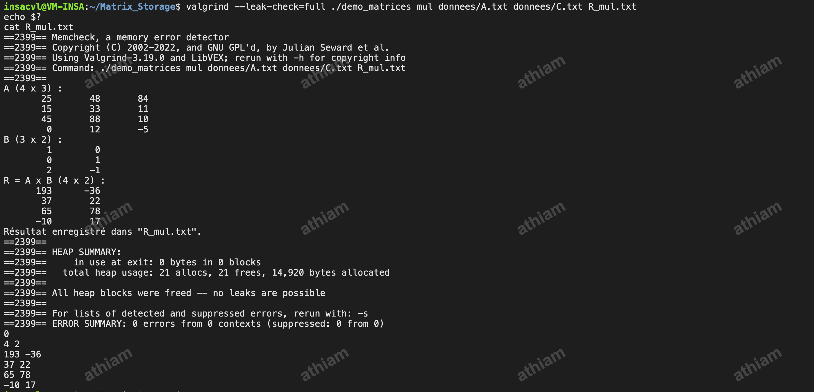

Code de retour : **0**. Le fichier affiché par `cat R_mul.txt` contient le produit attendu de dimensions 4 × 2. La seconde matrice est appelée B à l’écran car elle est le deuxième opérande. Valgrind ne détecte aucune fuite ni erreur mémoire.

### Scénario 3 — Dimensions incompatibles

Commande : `valgrind --leak-check=full ./demo_matrices add donnees/A.txt donnees/C.txt R_erreur.txt`.


Code de retour : **1**. Le message précise que les dimensions 4 × 3 et 3 × 2 sont incompatibles pour une addition. Le refus est attendu et les allocations sont libérées : Valgrind ne détecte aucune fuite ni erreur mémoire.

## 6. Bilan et répartition du travail 

Une difficulté rencontrée a été l’édition de liens : les fonctions `mat_afficher`, `mat_ecrire` et `mat_lire` étaient introuvables parce que `matrice_io.c` manquait dans la commande de compilation. L’ajout de ce module a résolu le problème. Le Makefile a ensuite été adapté pour construire les trois tests et le programme de démonstration avec les sources appropriées.

Le travail a été réparti de manière à ce que chacun touche un exercice !

Ce TD met en évidence l’importance des contrats entre modules et d’un nettoyage correct sur tous les chemins d’erreur. Les résultats fonctionnels et les contrôles Valgrind se complètent : obtenir une matrice correcte ne suffit pas si le programme fuit de la mémoire ou utilise des adresses invalides.


